# Screenshots

## Power BI dashboard

A five-page Power BI dashboard built on a star-schema model with 46 DAX measures. To use it yourself, download [2_Power_BI_Dashboard.pbix](../2_Dashboards/2_Power_BI_Dashboard.pbix) and open it in Power BI Desktop (free).

### Squad overview
Season-long load by team, monthly totals and the headline numbers.
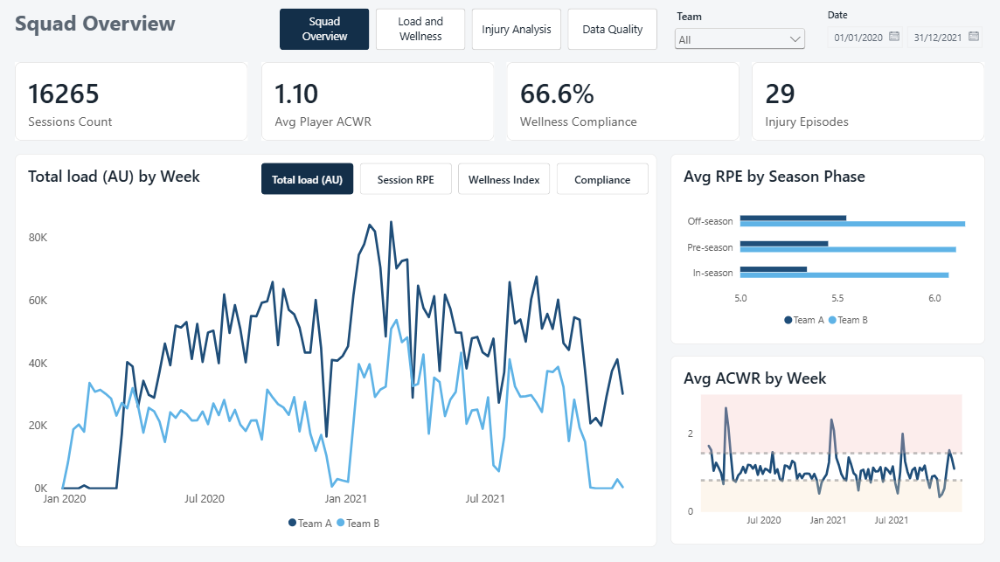

### Load and wellness: the weekly monitor
Every player's load against her wellness for the selected week. Players outside the safe ACWR range are flagged in red.
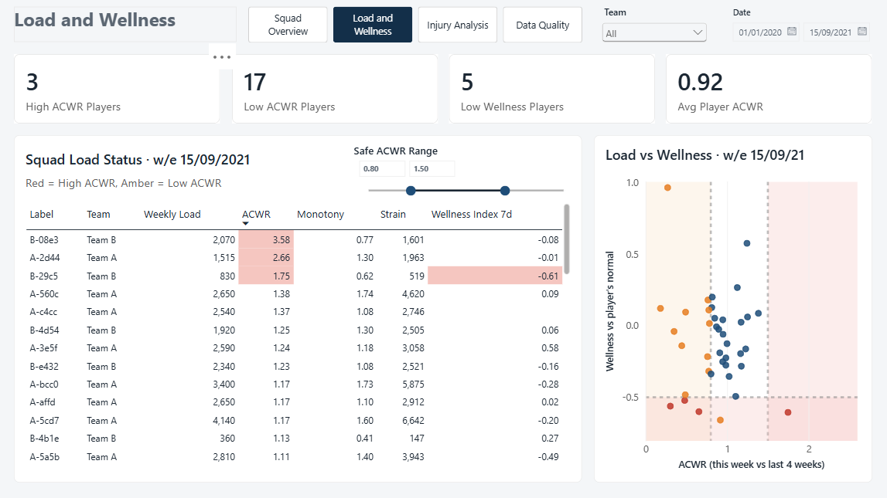

### The same page with the range slider moved
Staff set their own safe ACWR range with one slider, and every flag, colour and count updates.
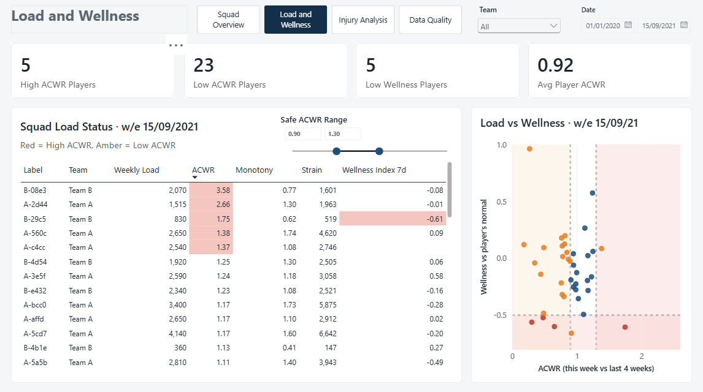

### Injury: wellness view
Injury episodes, body areas and how wellness changed around each injury.
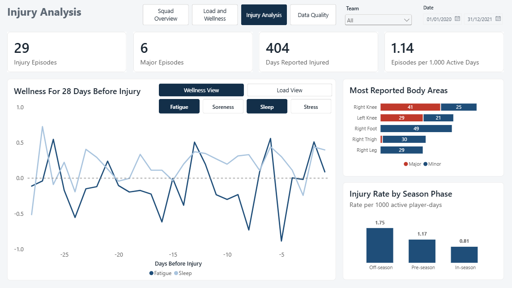

### Injury: load view
The same page switched to show load around each injury.
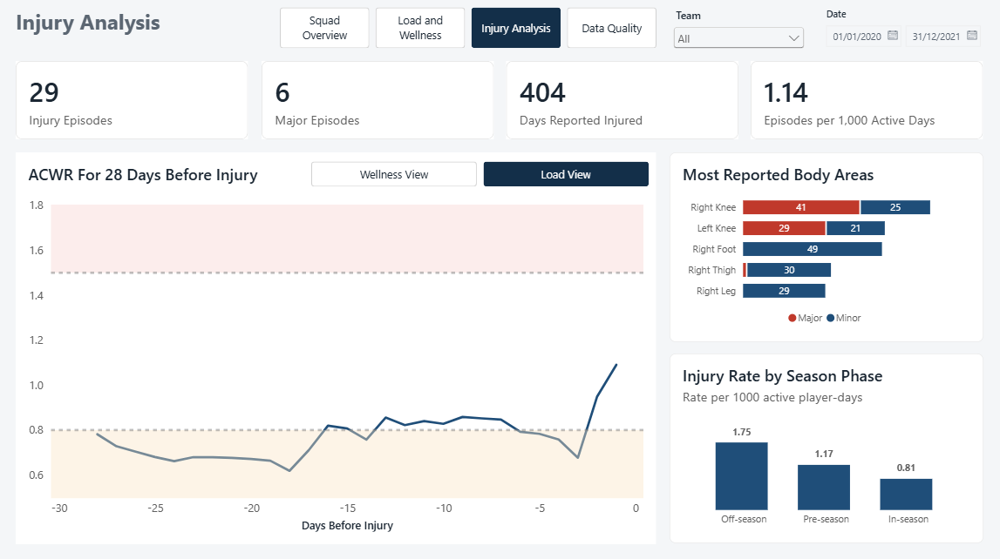

### Data quality
Wellness reporting by team and by player, so staff can see who to chase.
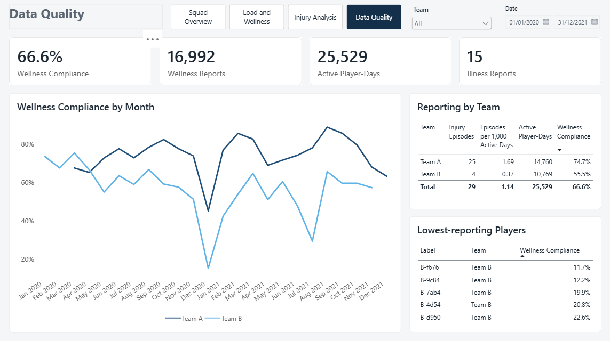

### Player profile (drill-through)
Right-click any player to open her full history of load, wellness and injuries.
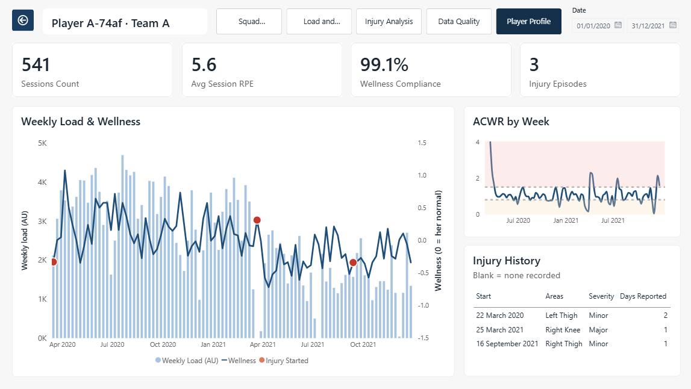

### Data model
The star schema behind the dashboard.
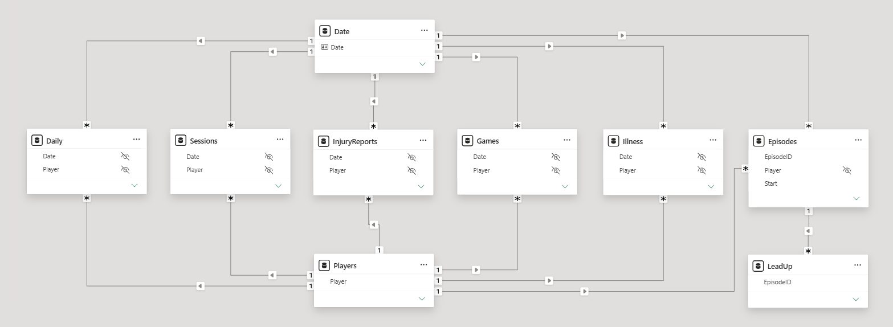

## R dashboard

Also available live: [open the R dashboard](https://will-page-495.github.io/soccermon-load-monitoring/2_Dashboards/1_R_Dashboard.html).

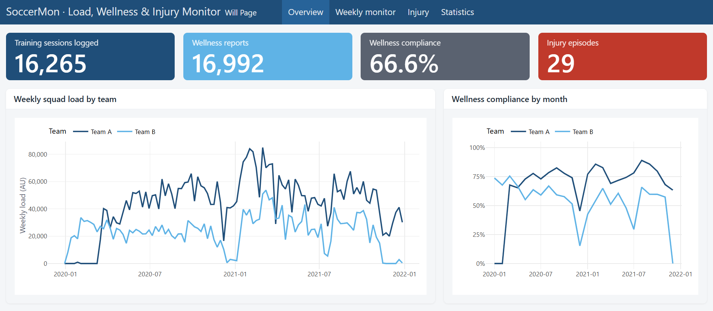
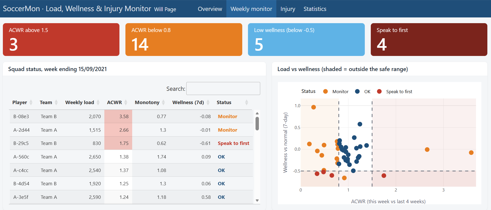
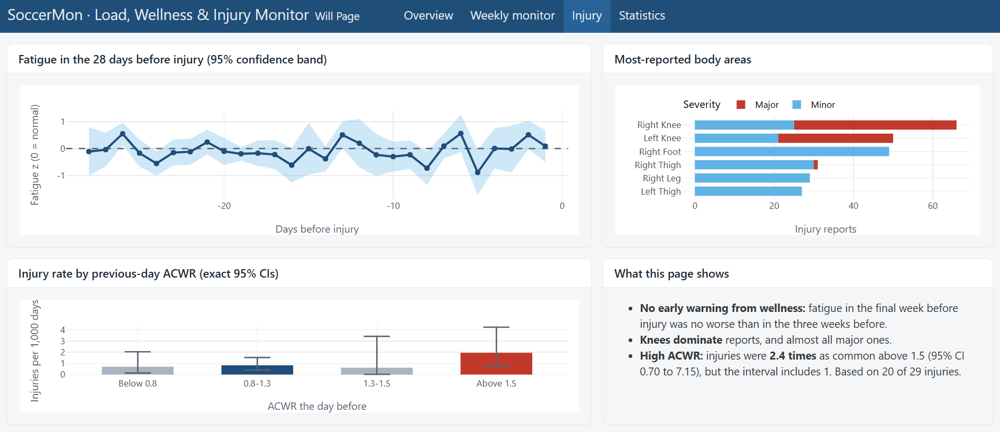
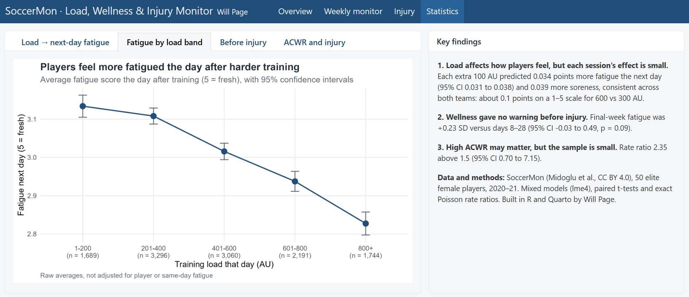

## Weekly squad report

Also available live: [open a sample report](https://will-page-495.github.io/soccermon-load-monitoring/3_Weekly_Reports/1_Week_ending_2021-09-15_All_players.html).

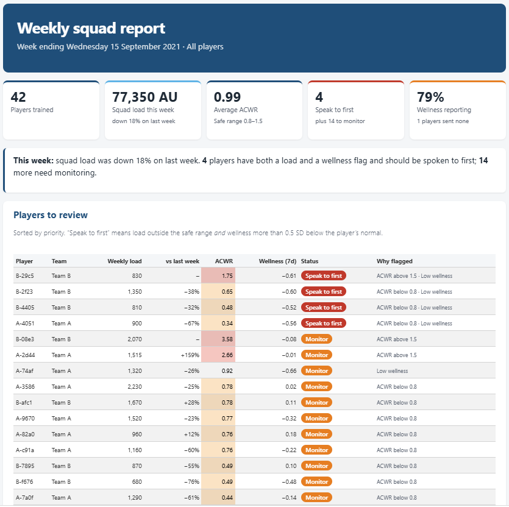
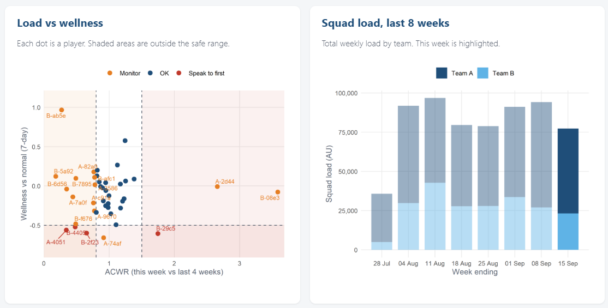
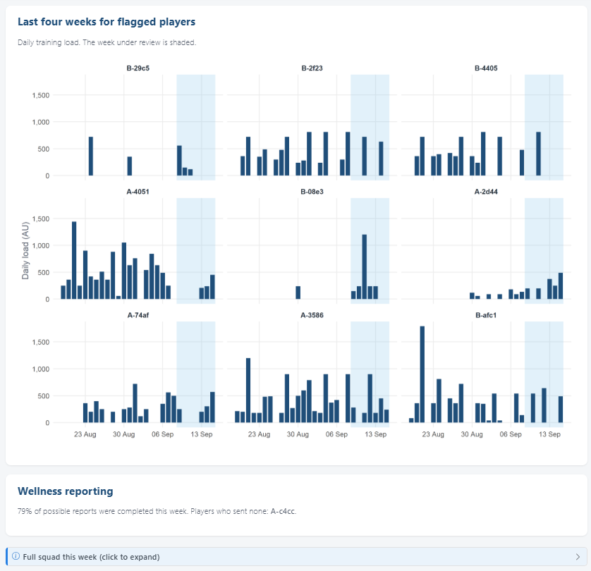
