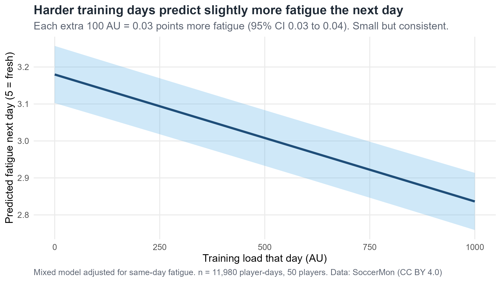
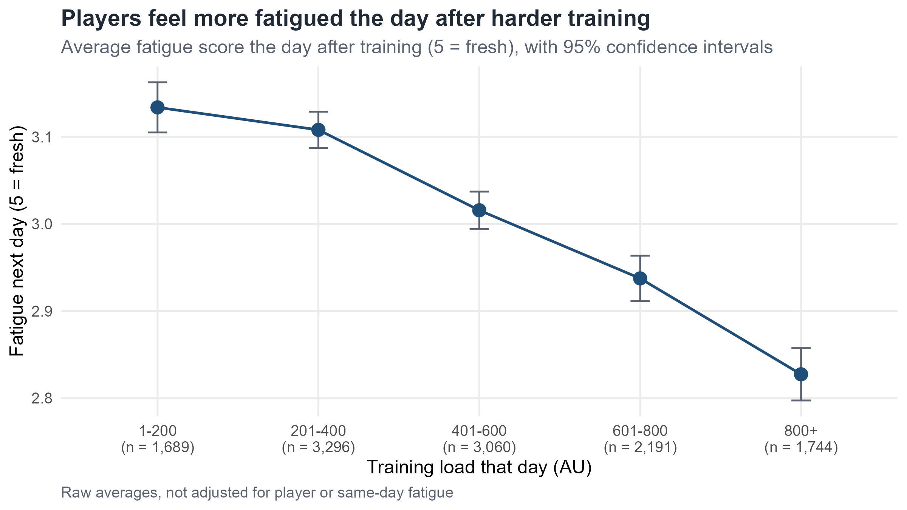
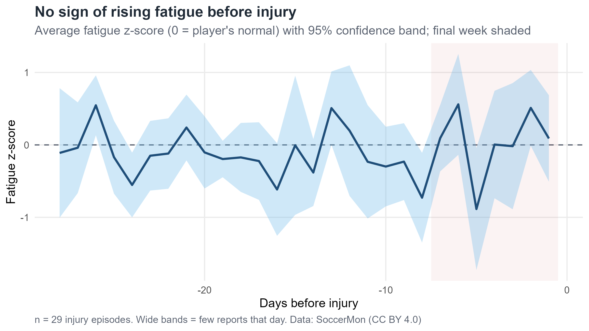
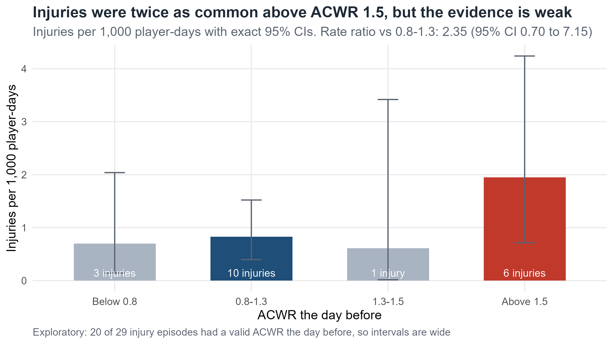

```{r}
#| include: false
library(readxl); library(dplyr); library(tidyr); library(ggplot2)
library(plotly); library(DT); library(scales)

excel_path <- "../6_Data/1_SoccerMon_Clean.xlsx"
out_dir    <- "results/"

daily    <- read_excel(excel_path, sheet = "Daily")    %>% mutate(Date = as.Date(Date))
sessions <- read_excel(excel_path, sheet = "Sessions")
episodes <- read_excel(excel_path, sheet = "Episodes") %>% mutate(Start = as.Date(Start))
leadup   <- read_excel(excel_path, sheet = "LeadUp")
reports  <- read_excel(excel_path, sheet = "InjuryReports")
players  <- read_excel(excel_path, sheet = "Players") %>%
  mutate(FirstActive = as.Date(FirstActive), LastActive = as.Date(LastActive))

num_cols <- c("DailyLoad", "WeeklyLoad", "ACWR", "Monotony",
              "Fatigue", "Soreness", "SleepQuality", "Stress",
              "Fatigue_z", "Soreness_z", "SleepQuality_z", "Stress_z")
daily  <- daily  %>% mutate(across(any_of(num_cols), ~ suppressWarnings(as.numeric(.x))))
leadup <- leadup %>% mutate(across(any_of(num_cols), ~ suppressWarnings(as.numeric(.x))))

# Colours and chart style (match the Power BI dashboard)
navy <- "#1F4E79"; light <- "#5FB3E6"; red <- "#C0392B"; orange <- "#E67E22"; grey <- "#5A6270"
team_cols <- c("Team A" = navy, "Team B" = light)
theme_dash <- theme_minimal(base_size = 12) +
  theme(panel.grid.minor = element_blank(), legend.title = element_blank(),
        axis.title = element_text(colour = grey, size = 11))

# Charts fill their card; same margins and legend position everywhere
tidy_plotly <- function(p) {
  ggplotly(p, tooltip = "text") %>%
    config(displayModeBar = FALSE, responsive = TRUE) %>%
    layout(margin = list(l = 65, r = 15, t = 35, b = 50),
           legend = list(orientation = "h", x = 0, y = 1.02, yanchor = "bottom"),
           font = list(family = "Segoe UI"))
}

# Compliance uses only days each player was at the club
active <- daily %>%
  left_join(select(players, Player, FirstActive, LastActive), by = "Player") %>%
  filter(Date >= FirstActive, Date <= LastActive)
compliance <- mean(!is.na(active$Fatigue))

# Weekly monitor snapshot
snap_date <- as.Date("2021-09-15")
well7 <- daily %>%
  filter(Date > snap_date - 7, Date <= snap_date) %>%
  group_by(Player) %>%
  summarise(across(c(Fatigue_z, Soreness_z, SleepQuality_z, Stress_z),
                   ~ mean(.x, na.rm = TRUE)), .groups = "drop") %>%
  mutate(across(-Player, ~ ifelse(is.nan(.x), NA, .x))) %>%
  rowwise() %>%
  mutate(Wellness7d = mean(c(Fatigue_z, Soreness_z, SleepQuality_z, Stress_z), na.rm = TRUE)) %>%
  ungroup() %>%
  mutate(Wellness7d = ifelse(is.nan(Wellness7d), NA, Wellness7d)) %>%
  select(Player, Wellness7d)

snap <- daily %>%
  filter(Date == snap_date, WeeklyLoad > 0) %>%
  left_join(select(players, Player, Label), by = "Player") %>%
  left_join(well7, by = "Player") %>%
  mutate(LoadFlag = coalesce(ACWR > 1.5 | (ACWR > 0 & ACWR < 0.8), FALSE),
         WellFlag = coalesce(Wellness7d < -0.5, FALSE),
         Status   = case_when(LoadFlag & WellFlag ~ "Speak to first",
                              LoadFlag | WellFlag ~ "Monitor",
                              TRUE ~ "OK"))

# Phase 6 results (read from the outputs folder so everything stays in sync)
q1 <- read.csv(paste0(out_dir, "2_q1_results.csv"), check.names = FALSE)
q2 <- read.csv(paste0(out_dir, "3_q2_results.csv"), check.names = FALSE)
q3 <- read.csv(paste0(out_dir, "4_q3_rates.csv"),   check.names = FALSE) %>%
  mutate(Band = factor(Band, levels = c("Below 0.8", "0.8-1.3", "1.3-1.5", "Above 1.5")))
fat <- q1[q1$Outcome == "Next-day fatigue", ]
sor <- q1[q1$Outcome == "Next-day soreness", ]
hi  <- q3[q3$Band == "Above 1.5", ]; ref <- q3[q3$Band == "0.8-1.3", ]
rr  <- poisson.test(c(hi$Injuries, ref$Injuries), c(hi$`Player-days`, ref$`Player-days`))
```

# Overview

## Row {height=18%}

```{r}
#| content: valuebox
#| title: "Training sessions logged"
list(color = navy, value = comma(nrow(sessions)))
```

```{r}
#| content: valuebox
#| title: "Wellness reports"
list(color = light, value = comma(sum(!is.na(daily$Fatigue))))
```

```{r}
#| content: valuebox
#| title: "Wellness compliance"
list(color = grey, value = percent(compliance, accuracy = 0.1))
```

```{r}
#| content: valuebox
#| title: "Injury episodes"
list(color = red, value = nrow(episodes))
```

## Row {height=82%}

### Column {width=62%}

```{r}
#| title: Weekly squad load by team
weekly <- daily %>%
  mutate(Week = as.Date(cut(Date, "week"))) %>%
  group_by(Week, Team) %>%
  summarise(Load = sum(DailyLoad, na.rm = TRUE), .groups = "drop")

p <- ggplot(weekly, aes(Week, Load, colour = Team, group = Team,
                        text = paste0(Team, "<br>Week of ", format(Week, "%d %b %Y"),
                                      "<br>Load: ", comma(Load), " AU"))) +
  geom_line(linewidth = 0.7) +
  scale_colour_manual(values = team_cols) +
  scale_y_continuous(labels = comma) +
  labs(x = NULL, y = "Weekly load (AU)") +
  theme_dash
tidy_plotly(p)
```

### Column {width=38%}

```{r}
#| title: Wellness compliance by month
monthly <- active %>%
  mutate(Month = as.Date(format(Date, "%Y-%m-01"))) %>%
  group_by(Month, Team) %>%
  summarise(Compliance = mean(!is.na(Fatigue)), .groups = "drop")

p <- ggplot(monthly, aes(Month, Compliance, colour = Team, group = Team,
                         text = paste0(Team, "<br>", format(Month, "%b %Y"), "<br>",
                                       percent(Compliance, accuracy = 0.1)))) +
  geom_line(linewidth = 0.7) +
  scale_colour_manual(values = team_cols) +
  scale_y_continuous(labels = percent, limits = c(0, 1)) +
  labs(x = NULL, y = NULL) +
  theme_dash
tidy_plotly(p)
```

# Weekly monitor

## Row {height=18%}

```{r}
#| content: valuebox
#| title: "ACWR above 1.5"
list(color = red, value = sum(snap$ACWR > 1.5, na.rm = TRUE))
```

```{r}
#| content: valuebox
#| title: "ACWR below 0.8"
list(color = orange, value = sum(snap$ACWR > 0 & snap$ACWR < 0.8, na.rm = TRUE))
```

```{r}
#| content: valuebox
#| title: "Low wellness (below -0.5)"
list(color = light, value = sum(snap$WellFlag))
```

```{r}
#| content: valuebox
#| title: "Speak to first"
list(color = "#7B241C", value = sum(snap$Status == "Speak to first"))
```

## Row {height=82%}

### Column {width=55%}

```{r}
#| title: "Squad status, week ending 15/09/2021"
snap %>%
  arrange(desc(ACWR)) %>%
  transmute(Player = Label, Team, `Weekly load` = WeeklyLoad, ACWR = round(ACWR, 2),
            Monotony = round(Monotony, 2), `Wellness (7d)` = round(Wellness7d, 2), Status) %>%
  datatable(rownames = FALSE, fillContainer = TRUE,
            options = list(paging = FALSE, dom = "ft", autoWidth = TRUE)) %>%
  formatRound("Weekly load", digits = 0) %>%
  formatStyle("ACWR", backgroundColor = styleInterval(c(0.8, 1.5), c("#FBE3C4", "white", "#F5C6C0"))) %>%
  formatStyle("Status", fontWeight = "bold",
              color = styleEqual(c("Speak to first", "Monitor", "OK"), c(red, orange, navy)))
```

### Column {width=45%}

```{r}
#| title: Load vs wellness (shaded = outside the safe range)
xr <- c(0, max(2, max(snap$ACWR, na.rm = TRUE) + 0.1))
yr <- range(snap$Wellness7d, na.rm = TRUE) + c(-0.2, 0.2)

p <- ggplot(snap, aes(ACWR, Wellness7d, colour = Status,
                      text = paste0(Label, " (", Team, ")<br>ACWR: ", round(ACWR, 2),
                                    "<br>Wellness: ", round(Wellness7d, 2), "<br>", Status))) +
  annotate("rect", xmin = 1.5, xmax = xr[2], ymin = yr[1], ymax = yr[2], fill = red, alpha = 0.07) +
  annotate("rect", xmin = xr[1], xmax = 0.8, ymin = yr[1], ymax = yr[2], fill = orange, alpha = 0.07) +
  annotate("rect", xmin = xr[1], xmax = xr[2], ymin = yr[1], ymax = -0.5, fill = red, alpha = 0.07) +
  geom_vline(xintercept = c(0.8, 1.5), linetype = "dashed", colour = grey) +
  geom_hline(yintercept = -0.5, linetype = "dashed", colour = grey) +
  geom_point(size = 3) +
  scale_colour_manual(values = c("Speak to first" = red, "Monitor" = orange, "OK" = navy)) +
  coord_cartesian(xlim = xr, ylim = yr, expand = FALSE) +
  labs(x = "ACWR (this week vs last 4 weeks)", y = "Wellness vs normal (7-day)") +
  theme_dash
tidy_plotly(p)
```

# Injury

## Row {height=55%}

### Column {width=60%}

```{r}
#| title: Fatigue in the 28 days before injury (95% confidence band)
lead <- leadup %>%
  group_by(DaysBefore) %>%
  summarise(m  = mean(Fatigue_z, na.rm = TRUE),
            se = sd(Fatigue_z, na.rm = TRUE) / sqrt(sum(!is.na(Fatigue_z))),
            n  = sum(!is.na(Fatigue_z)), .groups = "drop") %>%
  mutate(Day = -DaysBefore)

p <- ggplot(lead, aes(Day, m)) +
  geom_ribbon(aes(ymin = m - 1.96 * se, ymax = m + 1.96 * se), fill = light, alpha = 0.3) +
  geom_hline(yintercept = 0, linetype = "dashed", colour = grey) +
  geom_line(colour = navy, linewidth = 0.8) +
  geom_point(aes(text = paste0(DaysBefore, " days before injury<br>Mean z: ", round(m, 2),
                               "<br>Reports: ", n)), colour = navy, size = 1.5) +
  labs(x = "Days before injury", y = "Fatigue z (0 = normal)") +
  theme_dash
tidy_plotly(p)
```

### Column {width=40%}

```{r}
#| title: Most-reported body areas
area_tot <- reports %>% count(BodyArea, name = "Total") %>% slice_max(Total, n = 6, with_ties = FALSE)
areas <- reports %>%
  filter(BodyArea %in% area_tot$BodyArea) %>%
  mutate(Severity = tools::toTitleCase(as.character(Severity))) %>%
  count(BodyArea, Severity) %>%
  mutate(BodyArea = factor(BodyArea, levels = rev(area_tot$BodyArea)))

p <- ggplot(areas, aes(n, BodyArea, fill = Severity,
                       text = paste0(BodyArea, " · ", Severity, ": ", n, " reports"))) +
  geom_col(width = 0.7) +
  scale_fill_manual(values = c(Major = red, Minor = light)) +
  labs(x = "Injury reports", y = NULL) +
  theme_dash
tidy_plotly(p)
```

## Row {height=45%}

### Column {width=60%}

```{r}
#| title: Injury rate by previous-day ACWR (exact 95% CIs)
p <- ggplot(q3, aes(Band, Rate, fill = Band,
                    text = paste0(Band, "<br>", Injuries, " injuries in ", comma(`Player-days`),
                                  " player-days<br>Rate: ", round(Rate, 2), " per 1,000 (95% CI ",
                                  round(Low, 2), " to ", round(High, 2), ")"))) +
  geom_col(width = 0.6) +
  geom_errorbar(aes(ymin = Low, ymax = High), width = 0.15, colour = grey) +
  scale_fill_manual(values = c("#A9B4C2", navy, "#A9B4C2", red), guide = "none") +
  labs(x = "ACWR the day before", y = "Injuries per 1,000 days") +
  theme_dash
tidy_plotly(p)
```

### Column {width=40%}

::: {.card title="What this page shows"}
- **No early warning from wellness:** fatigue in the final week before injury was no worse than in the three weeks before.
- **Knees dominate** reports, and almost all major ones.
- **High ACWR:** injuries were **`r sprintf("%.1f", rr$estimate)` times** as common above 1.5 (95% CI `r sprintf("%.2f", rr$conf.int[1])` to `r sprintf("%.2f", rr$conf.int[2])`), but the interval includes 1. Based on `r sum(q3$Injuries)` of `r nrow(episodes)` injuries.
:::

# Statistics

## Row

### Column {.tabset width=62%}

::: {.card title="Load → next-day fatigue"}

:::

::: {.card title="Fatigue by load band"}

:::

::: {.card title="Before injury"}

:::

::: {.card title="ACWR and injury"}

:::

### Column {width=38%}

::: {.card title="Key findings"}
**1. Load affects how players feel, but each session's effect is small.** Each extra 100 AU predicted `r sprintf("%.3f", -fat$estimate)` points more fatigue the next day (95% CI `r sprintf("%.3f", -fat$conf.high)` to `r sprintf("%.3f", -fat$conf.low)`) and `r sprintf("%.3f", -sor$estimate)` more soreness, consistent across both teams: about 0.1 points on a 1–5 scale for 600 vs 300 AU.

**2. Wellness gave no warning before injury.** Final-week fatigue was `r sprintf("%+.2f", q2$estimate)` SD versus days 8–28 (95% CI `r sprintf("%.2f", q2$conf.low)` to `r sprintf("%.2f", q2$conf.high)`, p = `r sprintf("%.2f", q2$p.value)`).

**3. High ACWR may matter, but the sample is small.** Rate ratio `r sprintf("%.2f", rr$estimate)` above 1.5 (95% CI `r sprintf("%.2f", rr$conf.int[1])` to `r sprintf("%.2f", rr$conf.int[2])`).

**Data and methods:** SoccerMon (Midoglu et al., CC BY 4.0), 50 elite female players, 2020–21. Mixed models (lme4), paired t-tests and exact Poisson rate ratios. Built in R and Quarto by Will Page.
:::
