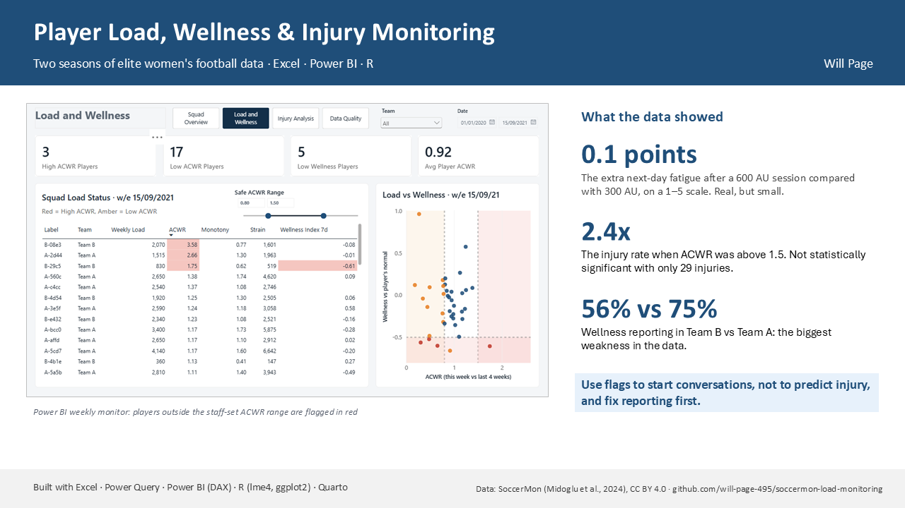

# Player Load, Wellness & Injury Monitoring

Two seasons of real training load, wellness and injury data from two elite women's football teams, turned into a Power BI dashboard, a statistical analysis in R, an R dashboard and an automated weekly squad report.

## Where to start

Short on time? Read them in this order:

| # | Look at | Time | What it is |
|---|---|---|---|
| 1 | [One-page summary](1_Reports/1_One_Page_Summary.png) | 1 min | The project and its three main findings on one page (shown above) |
| 2 | [Live R dashboard]([your dashboard link]) | 3 min | Interactive dashboard: overview, weekly monitor, injuries and statistics |
| 3 | [Full report](1_Reports/2_Full_Report.pdf) | 10 min | Page 1 is a plain-English summary for coaches; the rest is the technical report |
| 4 | [Case study](1_Reports/3_Case_Study_Return_From_Knee_Injury.pdf) | 3 min | One player's return from a major knee injury, and what the monitoring caught |
| 5 | [Screenshots](4_Screenshots) | 2 min | Every page of the Power BI dashboard, the R dashboard and the weekly report |

## Key findings

1. **Harder training days leave players slightly more fatigued the next day.** Each extra 100 AU of load predicted next-day fatigue 0.034 points worse on a 1–5 scale (95% CI 0.031 to 0.038), consistent across both teams. The effect is real but small: a 600 AU session compared with 300 AU moves next-day fatigue by about 0.1 points, and load explained only 7% of the variation in next-day fatigue.
2. **Wellness gave no early warning of injury.** Fatigue in the final week before injury was no worse than in the three weeks before it (+0.23 SD, 95% CI −0.03 to 0.49).
3. **Injuries were 2.4× as common when ACWR was above 1.5**, but with 29 injury episodes the evidence is weak (rate ratio 2.35, 95% CI 0.70 to 7.15).
4. **Knees made up 38% of injury reports and 70 of the 76 major reports.** Injury records show how long a player reported symptoms, not time lost from training.
5. **Reporting is the biggest data problem.** Players completed 67% of possible wellness forms (Team A 75%, Team B 56%), and Team B recorded only 4 of the 29 injuries.

**Case study:** one player's return from a major knee injury rebuilt load so quickly that her ACWR reached 2.29, and her wellness fell below the flag threshold in the same weeks. The weekly report would have flagged her in time.

## What I built

- **Excel / Power Query:** reshaped 15 wide CSV files (411,359 values) into 36,550 player-days, grouped 306 injury reports into 29 episodes, ran a data quality audit, and validated ACWR against the source data.
- **Power BI:** a star-schema model with 46 DAX measures and a five-page dashboard: an adjustable ACWR range slider, drill-through player profiles, metric switching, bookmarks and risk-coloured visuals.
- **R:** mixed-effects models on 10,966 player-days with robustness checks, pre-injury comparisons and exact Poisson rate ratios.
- **Quarto:** a four-page interactive R dashboard and a parameterised weekly squad report produced with one command.
- **Reports:** a full report for technical and non-technical staff, a one-page summary, a briefing for each department and a return-to-training case study.

## What's in each folder

| Folder | What's in it | How to open it |
|---|---|---|
| [1_Reports](1_Reports) | One-page summary, full report, case study, and a one-page briefing for each department (physio, S&C, psychology, nutrition, coaches) | Click any file to view it on GitHub |
| [2_Dashboards](2_Dashboards) | 1: the R dashboard. 2: the Power BI dashboard. 3: its colour theme | R dashboard: use the live link above. Power BI: download and open in Power BI Desktop (free) |
| [3_Weekly_Reports](3_Weekly_Reports) | Three sample weekly squad reports: all players, Team A (the week of the case-study injury), and Team B | Download and open in any browser |
| [4_Screenshots](4_Screenshots) | 01–08 Power BI, 09–12 R dashboard, 13–15 weekly report | Click any image |
| [5_Code](5_Code) | Every code file, numbered in the order it runs: 1–3 the R analysis, 4–5 the Quarto source for the dashboard and weekly report, 6 renders the sample reports, 7 the dashboard styling. `results/` holds the charts and results they produce, numbered to match | Open in RStudio |
| [6_Data](6_Data) | 1: the cleaned workbook built in Power Query, used by Power BI and R. 2: the data dictionary (every table and column explained). 3: the data licence and credit | Open the workbook in Excel; the other two open on GitHub |

## How to reproduce

1. Download the SoccerMon subjective data from Zenodo (link below) and unzip it.
2. Open `6_Data/1_SoccerMon_Clean.xlsx`, point Power Query at the unzipped folder (Data → Get Data → Data Source Settings), then Data → Refresh All.
3. Open `2_Dashboards/2_Power_BI_Dashboard.pbix` and click Refresh.
4. In RStudio, open `5_Code/1_analysis.R`, set the working directory to the `5_Code` folder (Session → Set Working Directory → To Source File Location) and run it. It writes every chart and result to `5_Code/results/`.
5. From the `5_Code` folder, render the R dashboard with `quarto render 4_dashboard.qmd`, and the sample weekly reports with `6_render_weekly_reports.R`.

Scripts 2 and 3 produce the full model output (Appendix C of the report) and the case study. Built with R 4.5.1; package versions are in `5_Code/results/7_session_info.txt`.

## Data

SoccerMon (Midoglu et al., 2024, *Scientific Data*): https://zenodo.org/records/10033832. Licensed CC BY 4.0. Players are anonymised in the source data. The raw data is not included here; download it from Zenodo. See [3_Data_Licence_and_Credit.md](6_Data/3_Data_Licence_and_Credit.md).

## Limitations

All data is self-reported, and reporting was uneven between players and teams. With 29 injury episodes, the injury analyses have little statistical power. Injury duration reflects reporting, not time lost. The data is observational, so it shows associations, not causes. The thresholds used (ACWR 0.8 and 1.5, wellness −0.5) are conventions, which is why the dashboard lets staff set their own.

## Author

Will Page, Sport & Exercise Science, University of Bath · https://www.linkedin.com/in/will-page-/
